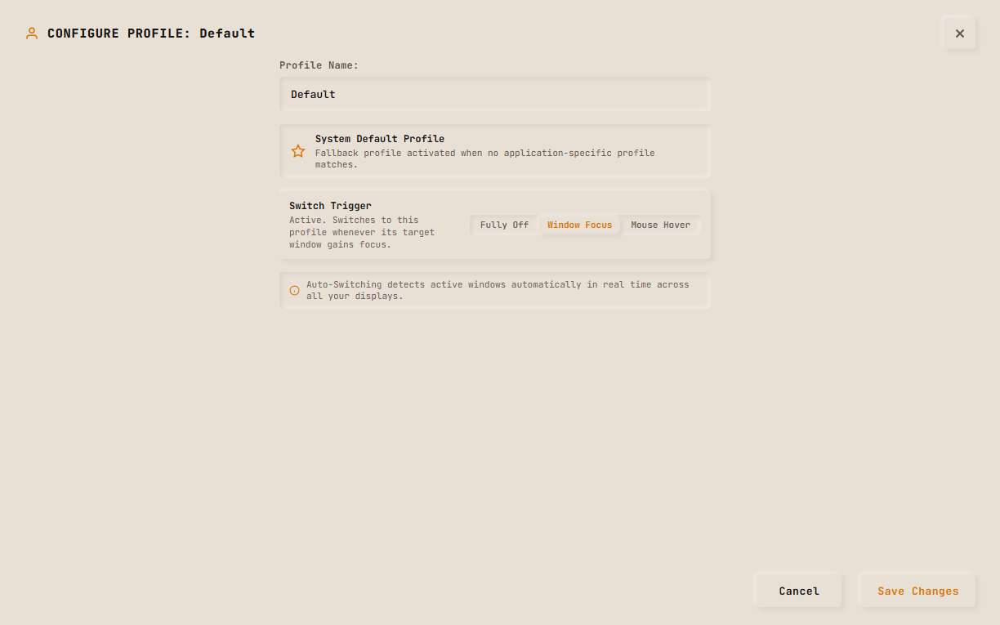
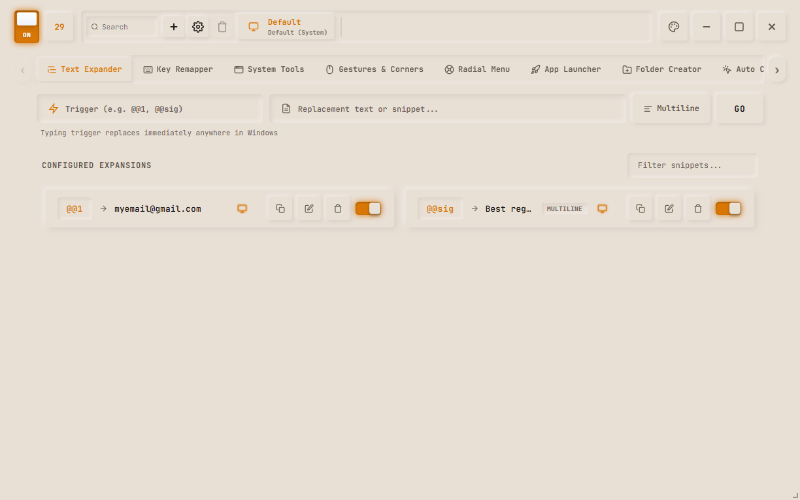
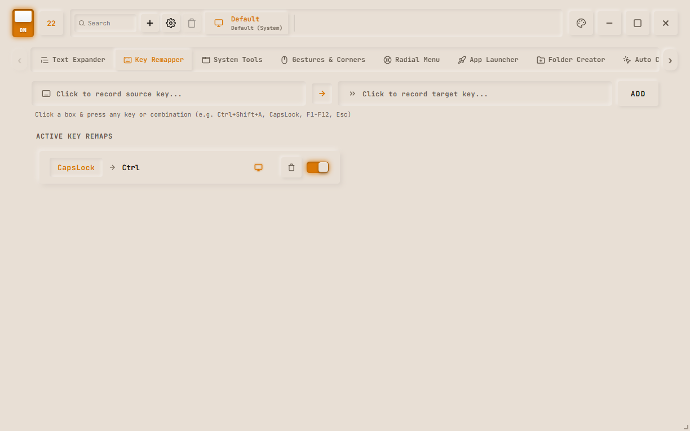
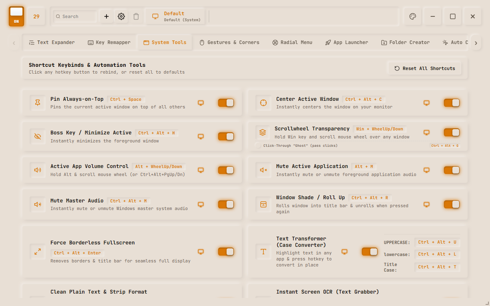
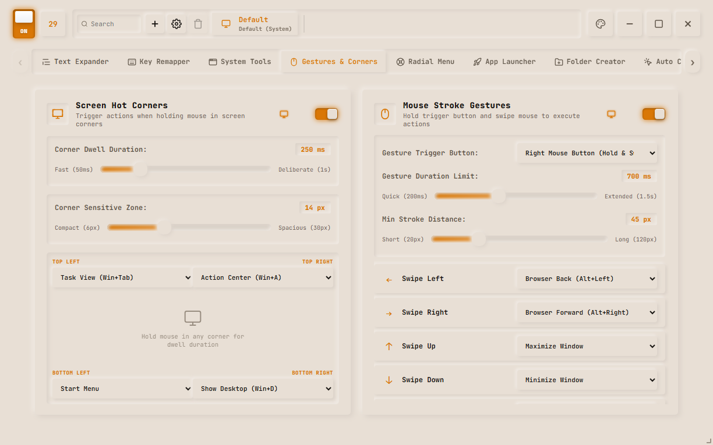
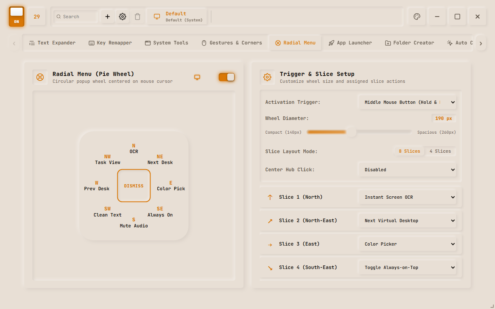
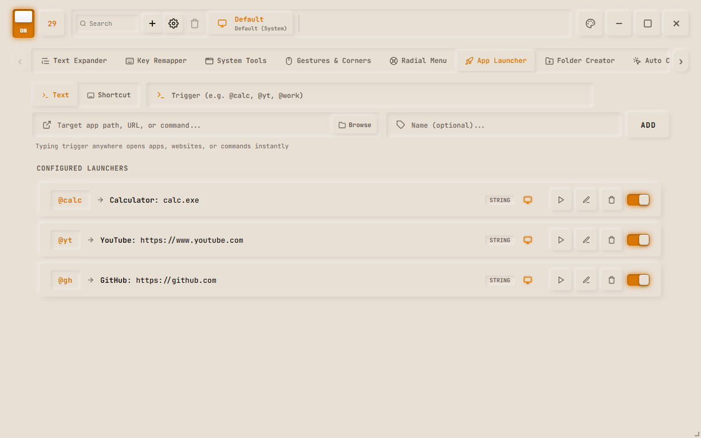
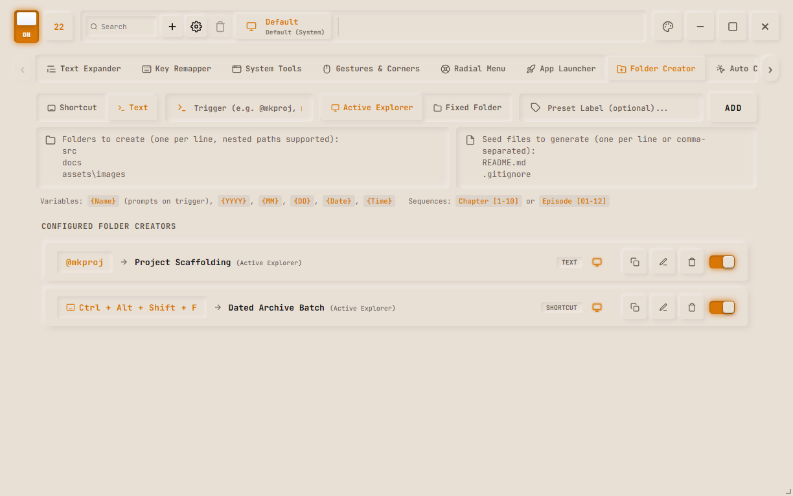
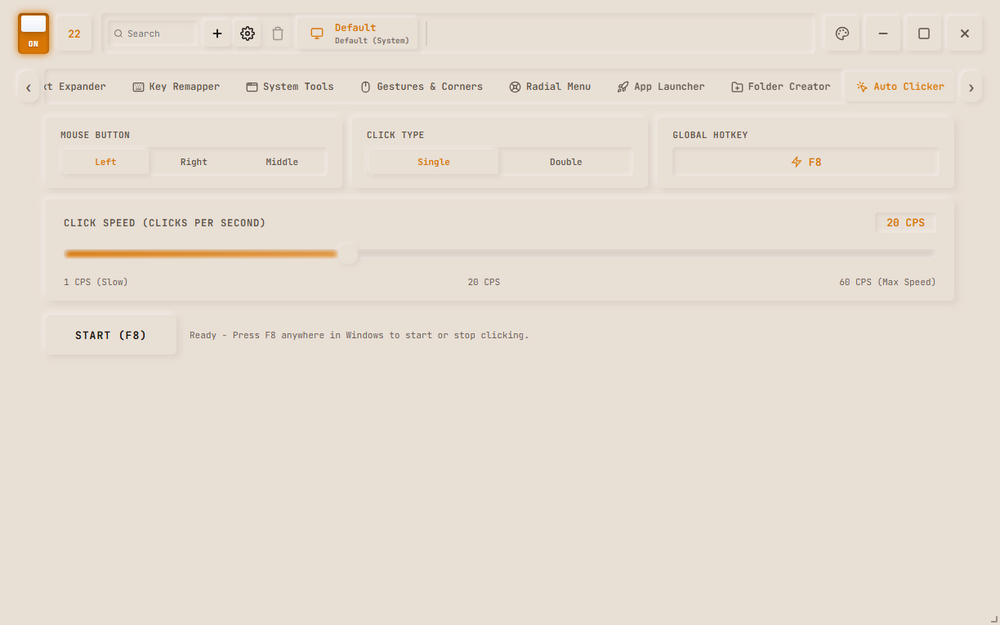
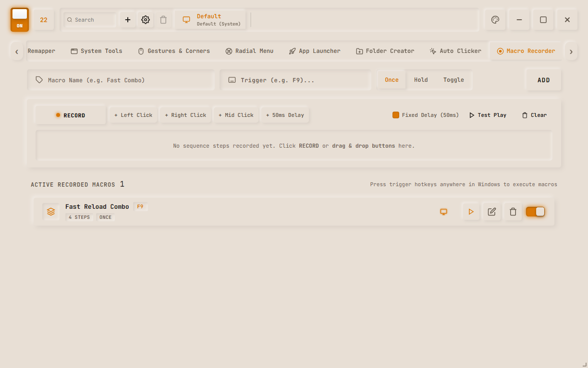

# AutoHotKeyboard

AutoHotKeyboard is an advanced Windows automation suite and desktop productivity utility. It combines **AutoHotkey v2** as the low-level automation engine with **Microsoft Edge WebView2** for a hardware-accelerated, tactile Neumorphic (Soft UI) interface.


---

## Application Profiles

The top ribbon bar provides application-specific profile management:

* **Automatic Context Switching**: Automatically activate scripts based on **Window Focus** or **Mouse Hover** over target application windows, or set to **Fully Off** for manual switching.
* **Per-Profile Automation**: Isolate hotkeys, macros, and text snippets to specific applications or games.
* **Cross-Profile Sharing**: Right-click any profile to copy and paste its active scripts into another profile.
* **Universal Script Forcing**: Right-click any script or toggle to force it to run globally across all profiles simultaneously with a single status indicator.



---

## Script Categories

### 1. Text Expander
Instant snippet expansion that triggers immediately upon typing the final character anywhere in Windows. Supports multiline formatting for signatures, email templates, and code blocks without clearing the clipboard.



---

### 2. Key Remapper
Remaps single keys and key combinations at the Windows low-level keyboard hook layer. Allows reassigning navigation keys, function keys, and custom modifiers with zero input latency.



---

### 3. System Tools
A centralized collection of window management and screen productivity utilities:
* **Precision Color Picker**: 60 FPS magnifying loupe following the mouse cursor with live multi-format conversion (HEX, RGB, HSL, HSV, CMYK).
* **Screen OCR (Text Grabber)**: Instant selection marquee to extract text from any screen area directly to clipboard.
* **Window Controls**: Always-on-Top toggle, window shading (collapse window up into its title bar), center window, boss key hide, and transparency wheel.
* **Quick PC Sleep Timer**: Countdown sleep and hibernation timer with Esc cancel hook.
* **Audio Controls**: Per-app volume adjustment and instant mute hotkeys.



---

### 4. Gestures & Corners
Cursor-driven productivity shortcuts that do not require keyboard input:
* **Screen Hot Corners**: Dwell cursor in any display corner to trigger custom actions.
* **Mouse Stroke Gestures**: Hold a trigger button (e.g., Middle Mouse Button) and draw directional strokes (Up, Down, Left, Right, Diagonals) to navigate tabs or manage windows.
* **Rocker Gestures**: Instant actions triggered by clicking Left and Right mouse buttons in sequence.
* **Taskbar Wheel Hopping**: Scroll the mouse wheel over the Windows taskbar to cycle virtual desktops.



---

### 5. Radial Menu
A modern 8-slice circular wheel menu accessible via global hotkey:
* **Interactive Configuration**: Live diameter slider (140px to 260px) and instant visual preview.
* **Slice Remapping**: Assign actions such as Screen OCR, Color Picker, Always-on-Top, Task View, and Media controls to individual slices.
* **Fast Selection**: Flick the mouse in the direction of any slice to execute without navigating menus.



---

### 6. App Launcher
Launch applications, documents, shell scripts, or URLs through two trigger modes:
* **String Triggers**: Type a short prefix in any text field (e.g., `@calc` for Calculator, `@gh` for GitHub).
* **Keyboard Hotkeys**: Trigger directly with global shortcut combinations.
* Includes a built-in file browser to locate executables and shortcuts.



---

### 7. Folder Creator
Automates batch directory scaffold creation. Define folder structures and generate complex directory hierarchies across your file system with a single click.



---

### 8. Auto Clicker
High-frequency automated mouse clicking engine:
* **Adjustable Speed**: Dial click rates from 1 to 60 Clicks Per Second (CPS).
* **Click Modes**: Left, Right, or Middle mouse button in Single or Double click modes.
* **Global Hotkey**: Toggle clicking on and off with acoustic feedback.



---

### 9. Macro Recorder
Records sequential keyboard inputs and plays them back on demand:
* **Configurable Timing**: Use standard fixed delays or preserve real-time user keystroke intervals.
* **Playback Modes**: Execute once or loop continuously until cancelled.
* **Trigger Binding**: Trigger macros via custom global hotkeys.



---

## Neumorphic Theme Customizer

The tactile Neumorphic (Soft UI) interface is fully customizable in real time:
* **Curated Presets**: Soft Clay, Obsidian Dark, Warm Sand, Retro Sharp, Cyber Violet, Sage Mint, and Arctic Frost.
* **Dynamic Sliders**: Granular control over corner radius, elevation distance, blur radius, light shadow intensity, and dark shadow depth.
* **Color Selection**: Custom background surface and accent primary colors with automatic text contrast optimization.


---

## Installation & Binaries

### Precompiled Releases
Prebuilt binaries are available in the repository root:
* **Standalone Portable Executable**: `AutoHotKeyboard.exe` (1.53 MB)
* **Windows Setup Installer**: `AutoHotKeyboard_Setup.exe` (2.78 MB)

### Running from Source
1. Ensure **Windows 10 / 11** with Edge WebView2 runtime is installed.
2. Install **AutoHotkey v2** from [autohotkey.com](https://www.autohotkey.com/v2/).
3. Run the application:
   ```powershell
   & "C:\Program Files\AutoHotkey\v2\AutoHotkey64.exe" "main.ahk"
   ```

### Building Release Binaries
Compile the standalone executable and Inno Setup installer:
```powershell
.\build.ps1
```

---

## License

MIT License. Open-source for personal and commercial use.
