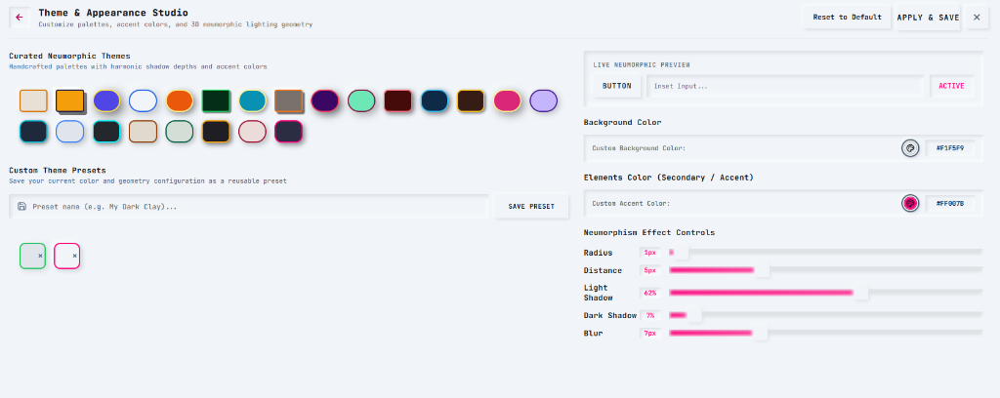
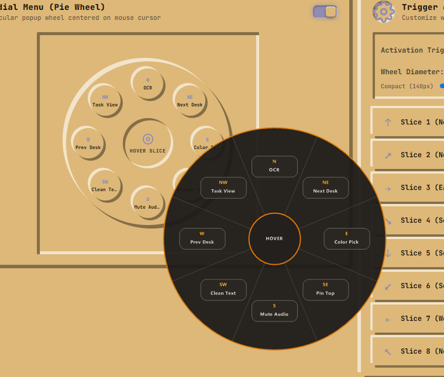
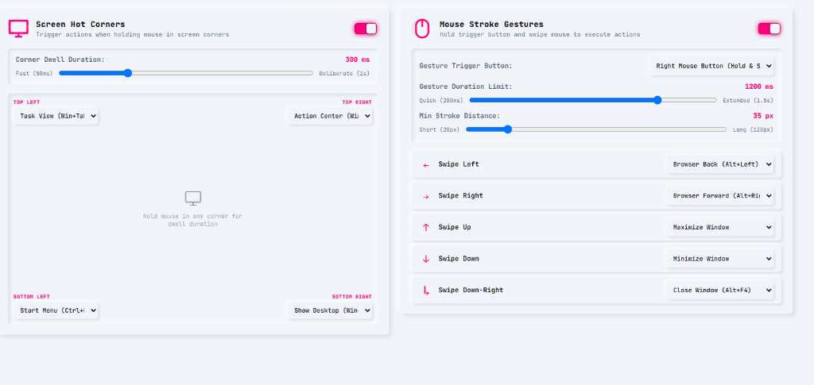

# AutoHotKeyboard

AutoHotKeyboard is an advanced Windows automation suite and productivity desktop utility. It combines **AutoHotkey v2** as the native automation engine with **Microsoft Edge WebView2** for a hardware-accelerated, tactile Neumorphic (Soft UI) interface.



---

## Core Features

### Application Profiles
* **Context-Aware Profiles**: Automatically switch active scripts and shortcuts based on active window focus or mouse hover.
* **Per-Profile Automation**: Assign dedicated hotkeys, macros, and text expansions per game or application.
* **Cross-Profile Sharing**: Right-click to copy and paste active script setups between profiles, or force individual scripts to run across all profiles simultaneously.



### Neumorphic Radial Menu
* **8-Slice Quick Wheel**: Access essential actions with a customizable radial wheel triggered by global hotkeys.
* **Interactive Configuration**: Live diameter scaling, slice assignment, and instant visual preview.
* **Default Actions**: Screen OCR, Color Picker, Always-on-Top, Task View, Virtual Desktop Navigation, and Audio Controls.


### Hot Corners & Mouse Gestures
* **Screen Hot Corners**: Execute actions by moving the cursor into screen corners with configurable dwell time.
* **Mouse Stroke Gestures**: Directional strokes (Up, Down, Left, Right, Diagonals) while holding a trigger button.
* **Rocker & Wheel Gestures**: Quick two-button rocker clicks and mouse wheel actions over targeted windows.

### System Tools & Screen Utilities
* **Precision Color Picker**: Real-time 60 FPS magnifying loupe following the mouse cursor across multi-monitor setups. Supports HEX, RGB, HSL, HSV, and CMYK formats.
* **Screen OCR (Text Grabber)**: Instant selection marquee to extract text from any screen region directly to clipboard.
* **Window Management**: Always-on-Top toggle, window shading (roll up to title bar), center window, boss key hide, and transparency adjustment.
* **Quick PC Sleep Timer**: Configurable countdown timer with sleep and hibernate modes.
* **Per-App Audio Control**: Mute and adjust volume for active background applications.

### Automation Modules
* **Text Expander**: Zero-latency text replacement with multiline formatting and clipboard preservation.
* **Key Remapper**: Low-level keyboard hook remapping for single keys and complex modifier combinations.
* **App Launcher**: Instant launch via custom keyboard shortcuts or prefix string triggers.
* **Macro Recorder**: Record and replay keyboard actions with configurable playback modes and loop intervals.
* **Auto Clicker**: High-performance click engine up to 60 CPS with single and double click modes.

---

## Tactile Neumorphic Theming

Customize the entire interface using hardware-accelerated CSS custom properties:
* Curated presets including Soft Clay, Obsidian Dark, Warm Sand, Retro Sharp, and Cyber Violet.
* Real-time sliders for corner radius, elevation distance, blur radius, and shadow contrast.
* Custom background and accent color picker with live contrast calculation.



---

## Installation & Usage

### Prebuilt Binaries
Precompiled releases are available in the repository root:
* **Standalone Portable Executable**: `AutoHotKeyboard.exe`
* **Windows Setup Installer**: `AutoHotKeyboard_Setup.exe`

### Running from Source
1. Ensure **Windows 10 / 11** with the Edge WebView2 runtime is installed.
2. Install **AutoHotkey v2** from [autohotkey.com](https://www.autohotkey.com/v2/).
3. Clone the repository and execute:
   ```powershell
   & "C:\Program Files\AutoHotkey\v2\AutoHotkey64.exe" "main.ahk"
   ```

### Building Release Binaries
To compile both the standalone executable and the setup installer:
```powershell
.\build.ps1
```

---

## Project Structure

```text
AutoHotKeyboard/
├── main.ahk                  # AutoHotkey v2 core engine & IPC dispatcher
├── build.ps1                 # Automated compiler & installer pipeline
├── config.json               # User profile state & configuration
├── installer/
│   └── installer.iss         # Inno Setup installer script
├── docs/
│   └── screenshots/          # Application screenshots
├── lib/                      # Core dependencies (JSON, OCR, Promise, WebView2)
└── ui/                       # Front-end user interface
    ├── index.html            # Semantic layout & modals
    ├── style.css             # Neumorphic design system & dynamic variables
    └── app.js                # Two-way WebView2 IPC bridge
```

---

## License

MIT License. Open-source for personal and commercial use.
